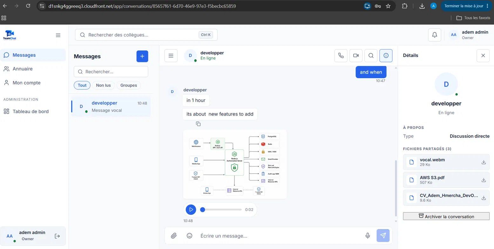
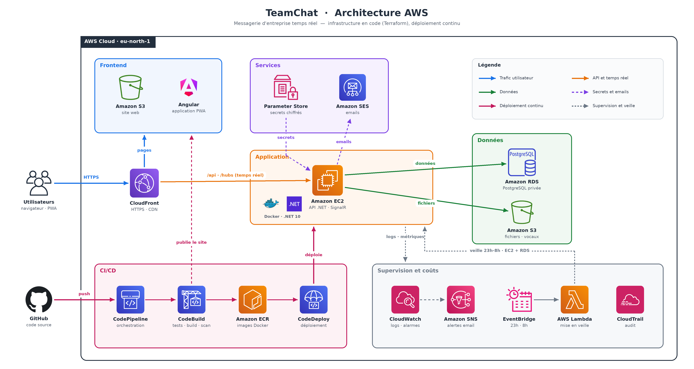
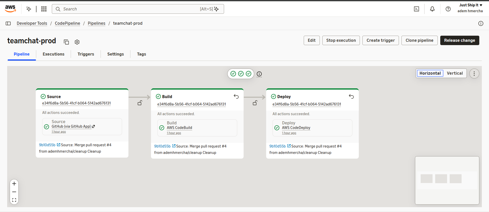
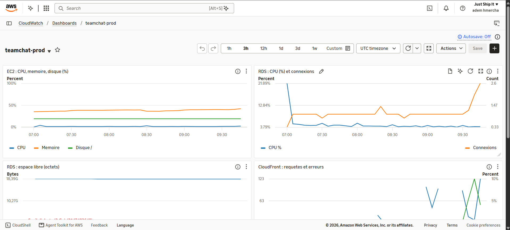
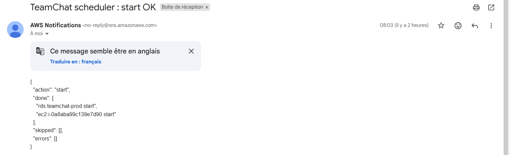

# TeamChat

Messagerie d'entreprise en temps réel : conversations, fichiers, vocaux et appels audio/vidéo, pour plusieurs sociétés isolées les unes des autres. Hébergée sur AWS et déployée automatiquement.

**Démo en ligne : [https://d1snkg4ggeeeq3.cloudfront.net](https://d1snkg4ggeeeq3.cloudfront.net)**

La démo est mise en veille chaque nuit de 23h à 8h (UTC+1) pour limiter les coûts ; elle redémarre toute seule.

## Aperçu

| Fonctionnalité | Détail |
|---|---|
| Messagerie temps réel | Conversations privées et groupes, modification et suppression, « en train d'écrire », messages non lus, présence en ligne |
| Fichiers et vocaux | Images et documents (types et taille contrôlés), messages vocaux enregistrés dans le navigateur |
| Appels | Audio et vidéo en 1-à-1 (WebRTC), caméra optionnelle, partage d'écran |
| Annuaire | Recherche des collègues, pastille en ligne / hors ligne |
| Administration | Membres, rôles, groupes et tableau de bord de statistiques ; chaque société est isolée |
| Connexion sécurisée | Email et mot de passe ou compte Google ; jetons de courte durée renouvelés automatiquement |
| Application installable | PWA : s'installe sur mobile et ordinateur, page hors ligne |

## Captures d'écran



## Architecture



1. **Point d'entrée unique** : CloudFront, en HTTPS, qui répartit le trafic.
2. **Site** : application Angular statique, stockée dans S3.
3. **API** : ASP.NET Core et SignalR (temps réel) dans un conteneur Docker sur EC2, joignable uniquement via CloudFront.
4. **Données** : PostgreSQL (RDS, base privée), fichiers dans S3, emails via SES.
5. **Secrets** : stockés dans SSM Parameter Store et lus au déploiement ; aucun secret ni clé d'accès dans le dépôt.

## Technologies

| Domaine | Choix |
|---|---|
| Frontend | Angular 21 (composants standalone, signals), PWA |
| Backend | ASP.NET Core (.NET 10), SignalR, Clean Architecture |
| Base de données | PostgreSQL 16 (Amazon RDS), EF Core, cache HybridCache (Redis optionnel) |
| Appels | WebRTC, signalisation par SignalR, STUN |
| Cloud | AWS `eu-north-1` : CloudFront, S3, EC2, RDS, SES, SSM, ECR, Lambda, EventBridge, CloudWatch, SNS, CloudTrail |
| Infrastructure | Terraform |
| CI/CD | CodePipeline, CodeBuild, CodeDeploy |
| Tests | xUnit, Moq, Testcontainers (PostgreSQL), Vitest |

## Déploiement continu

```text
Pull request ──► build + tests (CodeBuild)
Merge sur main ──► tests + image Docker + scan de sécurité ──► déploiement (CodeDeploy) ──► contrôle de santé
```


*Pipeline AWS : chaque fusion sur main est testée, construite et déployée automatiquement.*

- **Tests** : les tests unitaires et d'intégration (sur une vraie base PostgreSQL) doivent passer avant toute publication.
- **Scan de sécurité** : l'image Docker est analysée ; une vulnérabilité critique bloque le déploiement.
- **Annulation automatique** : si l'API ne répond pas après le déploiement, CodeDeploy revient à la version précédente.

## Exploitation

| Domaine | En place |
|---|---|
| Surveillance | Alarmes CloudWatch (serveur, base, erreurs de l'API) avec alertes par email, tableau de bord, journaux JSON |
| Coûts | Arrêt automatique du serveur et de la base chaque nuit (Lambda), budget AWS avec alertes |
| Sécurité | Droits IAM minimaux, base privée, accès public S3 bloqué, mots de passe hachés, journal d'audit CloudTrail |
| Sauvegardes | Sauvegardes automatiques de la base (restauration à un instant donné sur les dernières 24 h), fichiers versionnés |
| Reproductibilité | Toute l'infrastructure est décrite en Terraform |


*Tableau de bord CloudWatch : serveur et base de données*

**Mise en veille automatique** : chaque soir à 23h, une fonction Lambda arrête le serveur et la base de données, puis les redémarre à 8h. Un email confirme chaque action.



## Lancer le projet en local

Prérequis : [.NET SDK 10](https://dotnet.microsoft.com/download), [Node.js](https://nodejs.org/) 20.19+, [Docker](https://www.docker.com/products/docker-desktop/).

```bash
docker compose --profile app up -d --build   # PostgreSQL + API sur http://localhost:5285
cd frontend && npm install                   # dépendances du site
npm start                                    # site sur http://localhost:4200
```

Créez ensuite votre société sur `/register`. Tests : `dotnet test backend/TeamChat.sln` et `cd frontend && npm test`.

## Structure du projet

| Dossier | Rôle |
|---|---|
| `backend/` | API .NET (Domain, Application, Infrastructure, Api) et ses tests |
| `frontend/` | Application Angular |
| `infra/` | Infrastructure AWS en Terraform (réseau, base, CDN, pipeline, supervision) |
| `aws/` | Scripts de déploiement, build des pull requests, fonction CloudFront |
| `docs/` | Schéma d'architecture et captures d'écran |

## Prochaines étapes

- **Domaine personnalisé** avec HTTPS (Route 53 et ACM).
- **Serveur TURN** pour les appels derrière des réseaux restrictifs.
- **Pré-production** : un second environnement identique, déployé par le même Terraform.
- **Montée en charge** : plusieurs instances d'API, Redis pour le cache et le temps réel, base redimensionnée.

## Auteur

**Adem Hmercha** · [github.com/ademhmercha](https://github.com/ademhmercha)
